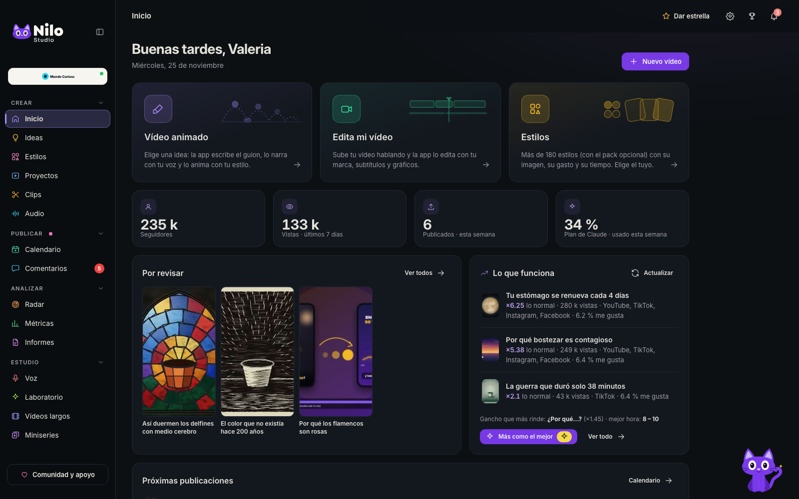
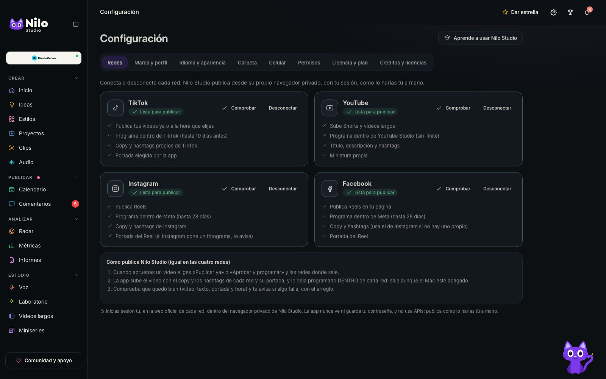
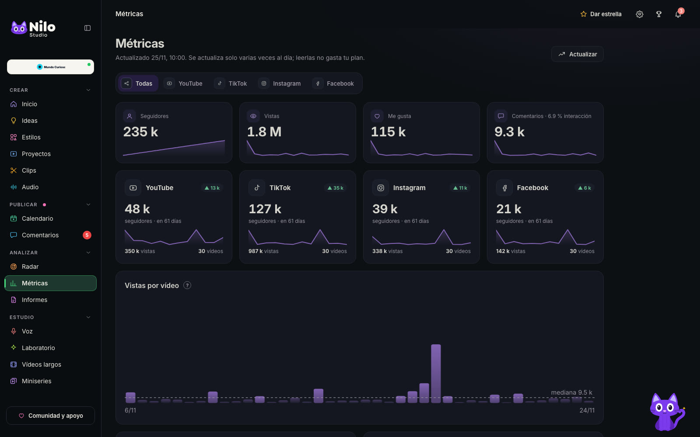
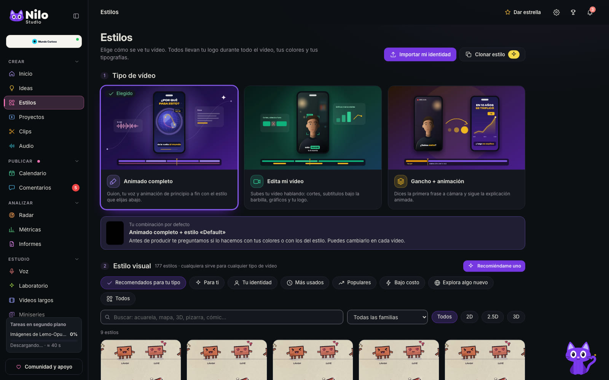
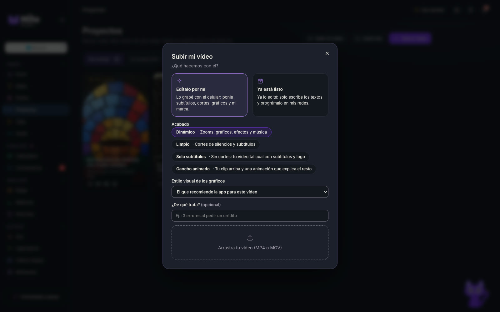
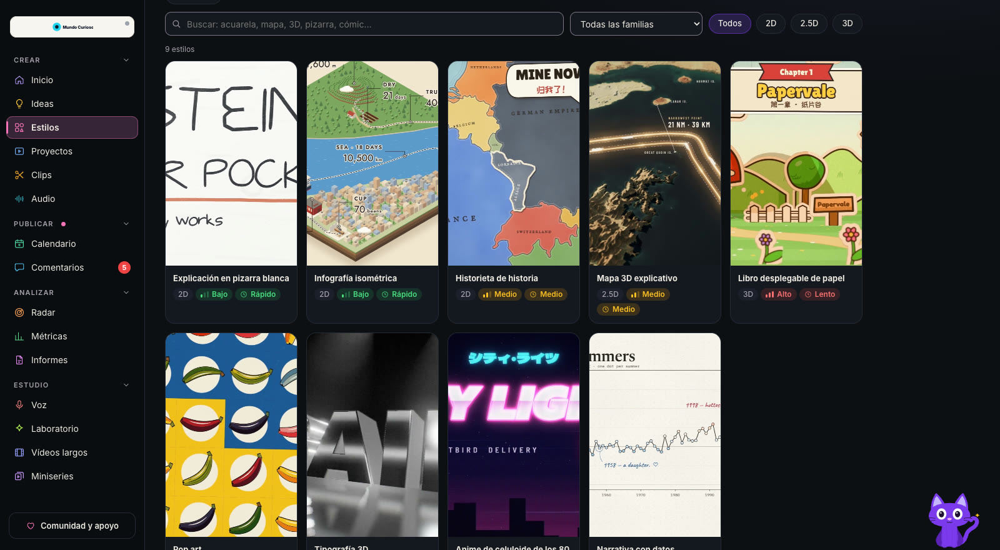
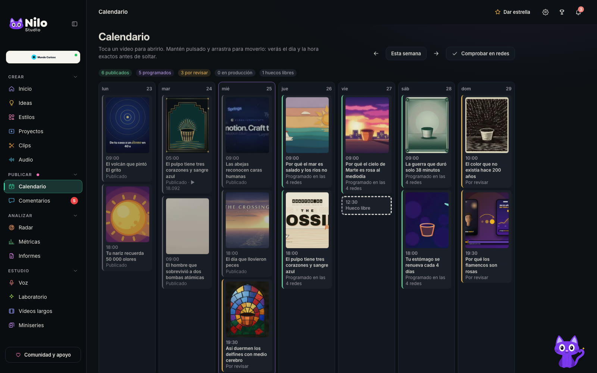
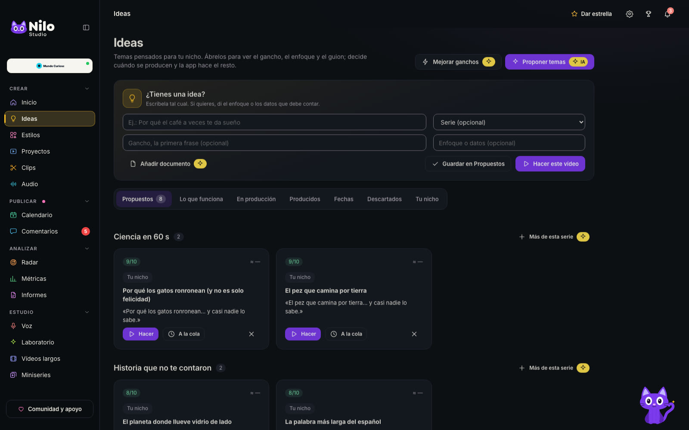
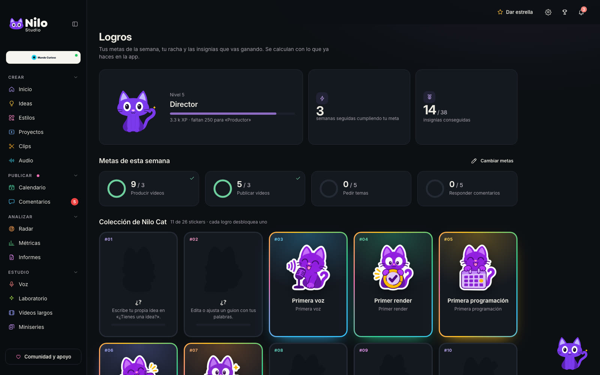
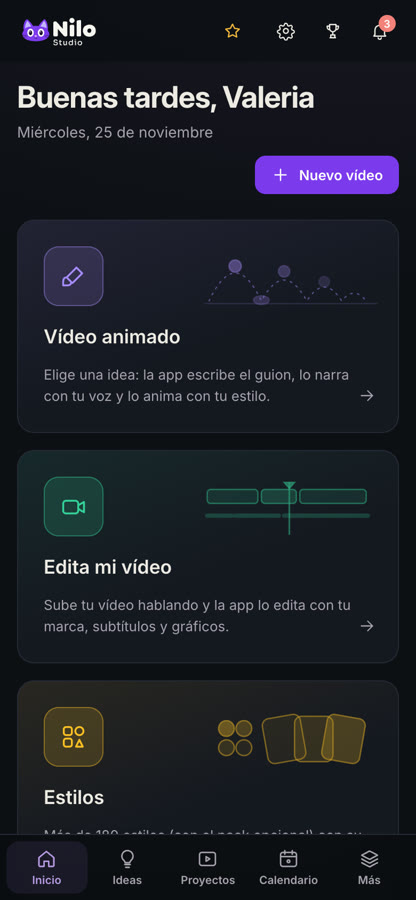

<picture>
  <source media="(prefers-color-scheme: dark)" srcset="assets/logo-oscuro.svg">
  
</picture>

### Crea vídeos con IA para TikTok, Reels y Shorts en tu Mac. Sin editar nada.
**Una idea → un vídeo animado con tu voz → programado en TikTok, Instagram, YouTube y Facebook.**
**Sin editar nada.**

 

---

## ✨ Qué hace, en 10 segundos

| | |
|---|---|
| 💡 **Te propone temas** | De tu nicho, de lo que es tendencia y de lo que ya te funcionó. |
| ✍️ **Escribe el guion** | Con ganchos que retienen, en tu tono. |
| 🎙️ **Lo narra con tu voz** | Tu voz clonada, o una voz gratis. |
| 🎬 **Lo anima** | En el estilo que elijas, con tu logo, tus colores y subtítulos. |
| 📅 **Lo programa** | En TikTok, Instagram, YouTube y Facebook, desde tu propio navegador. |
| 📈 **Aprende** | Mira tus métricas y te propone más de lo que funciona. |

> Tú solo eliges la idea y apruebas el vídeo. **Nada se publica sin tu aprobación.**

---

## 🚀 Publica y programa en las 4 redes, de verdad

Lo que más tiempo quita no es hacer el vídeo: es subirlo cuatro veces. Nilo Studio lo hace por ti **dentro de cada red**, con tu sesión y sin APIs:

- **Publicar ahora** o **programar** en TikTok, YouTube, Instagram y Facebook, con su texto, sus hashtags y su portada.
- Queda programado **dentro de la propia red**: sale a su hora aunque el Mac esté apagado.
- **Mover a otra fecha o cancelar** en un clic: la app borra la programación dentro de cada red y la vuelve a crear.
- **Eliminar de las redes** un vídeo ya publicado y reprogramarlo cuando quieras.
- Todo se ve en **segundo plano** con su avance, y te avisa cuando se publica (también en el celular).

## 📈 «Lo que funciona», con los datos de tus 4 redes

Lee las métricas de YouTube, TikTok, Instagram y Facebook y compara cada vídeo con lo normal de su red: ves cuáles rindieron ×5, ×10 o ×19, qué tipo de gancho funciona y a qué hora publicar. Con un clic, **«Más como este»** te propone ideas parecidas a tus ganadores.

---

## 🎞️ Tres formas de hacer un vídeo

1. **Vídeo animado**: desde una idea. Guion, voz y animación de principio a fin.
2. **Edita mi vídeo**: subes lo que grabaste con el celular y elige el acabado:
   - **Dinámico**: zooms, gráficos y efectos.
   - **Limpio**: cortes y subtítulos.
   - **Solo subtítulos**: tu vídeo tal cual, con subtítulos.
   - **Gancho animado**: tu clip al inicio y una animación que explica el resto.
3. **Ya está listo**: subes un vídeo terminado. La app lo escucha o lee sus subtítulos, escribe los textos de cada red y lo deja listo para programar.

---

## 🎨 Más de 180 estilos de animación

Pizarra, acuarela, papel recortado, 3D, pixel art, cómic, holograma, prensa antigua, low‑poly… Todos con **tu logo, tus colores y tus tipografías**. *(84 incluidos + 97 del pack opcional gratuito Lemo-Opuscar, de terceros con licencia no comercial, que instalas con un clic).* Cada estilo te dice cuánto tarda y cuánto gasta.

---

## 🗓️ Tu semana, en piloto automático

<table>
<tr>
<td width="50%"></td>
<td width="50%"></td>
</tr>
<tr>
<td align="center"><b>Calendario</b>: arrastra un vídeo para cambiarlo de día.</td>
<td align="center"><b>Ideas</b>: temas de tu nicho y de lo que es tendencia.</td>
</tr>
<tr>
<td width="50%"></td>
<td width="50%"></td>
</tr>
<tr>
<td align="center"><b>Nilo, el gato</b>: logros, stickers y accesorios mientras creas.</td>
<td align="center"><b>Métricas</b>: qué funcionó y qué hacer más.</td>
</tr>
</table>

---

## 🏆 Lo que nadie más hace

- **Publica, programa, mueve y borra en 4 redes sin APIs ni permisos raros**: usa tu propio navegador, como lo harías tú.
- **Aprende de tus datos reales**: compara cada vídeo con lo normal de su red y te propone más de lo que funciona.
- **Corre en tu Mac**: tus vídeos, tu voz y tus cuentas no salen de tu equipo.
- **Funciona con tu plan de Claude**: no pagas otra IA por cada vídeo.
- **Todo en español**, pensado para creadores de Latinoamérica y España.
- **Importa tu marca en un clic**: si ya trabajas con Claude o ChatGPT, pegas un bloque y la app se configura sola.
- **Te avisa con un gato** 🐈‍⬛ cuando tu vídeo está listo. En serio.

 Revisa y aprueba tus vídeos desde el celular.

---

## 💳 Precio

### Nilo Studio Pro

| **Pro mensual** | **Pro anual** · mejor valor |
|:---:|:---:|
| **USD 9,99** al mes | **USD 79** al año (más de 4 meses gratis) |

Todo Nilo Studio · licencia personal para **hasta 2 Mac tuyos** · actualizaciones incluidas · cancela cuando quieras · **Garantía de 14 días**.

**[→ Obtener Pro](https://gumroad.com/l/nilostudio-pro)** · Más información en **[la web](https://danerrq.github.io)**

---

## 🧰 Qué necesitas

- Un **Mac**.
- Un plan de **Claude** (Pro o Max) con Claude Code. *No funciona con ChatGPT.*
- Tus redes abiertas en el navegador. Inicias sesión tú: la app nunca ve tus contraseñas.

## 🚀 Instalación

1. Elige tu plan Pro. Te llega al correo el enlace de descarga y tu clave de licencia.
2. Descomprime **NiloStudio**, muévela a Documentos y ábrela en Claude Code.
3. Escribe *«instala Nilo Studio»*. Claude lo prepara todo y deja la app **Nilo Studio** en Aplicaciones y en el Dock.
4. Pega tu clave y sigue la encuesta de 5 minutos, o importa tu perfil desde tu chat.

Las actualizaciones llegan solas: la app te avisa y se instalan con un clic.

---

## ❓ Preguntas frecuentes

<b>¿Me pueden bloquear la cuenta?</b>

La app publica desde tu navegador, con tu sesión y solo lo que tú apruebas, como lo harías tú. Cada red tiene sus propias normas sobre automatización: úsala con un ritmo normal. No podemos garantizar lo que decida cada red sobre tu cuenta.

<b>¿Cuántos vídeos salen con Claude Pro?</b>

Depende del estilo: cada estilo indica su gasto y su tiempo. Funciona con tu plan de Claude (Pro o Max), según los límites de tu plan.

<b>¿Funciona en Windows?</b>

Por ahora solo en Mac. Windows está en la hoja de ruta.

<b>¿En cuántos Mac la puedo usar?</b>

Tu licencia es para ti y la puedes activar en hasta 2 Mac tuyos (por ejemplo, el portátil y el de escritorio). Si cambias de Mac, en Configuración › Licencia pulsas «Pasar mi licencia a otro Mac» y la activas en el nuevo.

<b>¿Puedo usarla desde el celular?</b>

Sí: escaneas un código en Configuración › Celular y la abres en el navegador del celular para revisar, aprobar y programar. Fuera de casa funciona con Tailscale (gratis).

---

## 🧩 Qué es nuestro y qué usamos de otros

**Creado por Nilo Studio:**
- la automatización de un clic, de la idea al vídeo programado;
- el método de guiones y ganchos;
- la publicación y programación en TikTok, Instagram, YouTube y Facebook sin APIs;
- la importación de tu perfil desde tu chat, los kits de marca, el radar de tendencias, el calendario, las métricas y los informes;
- el motor de animación «Default» y la producción por estilos;
- Nilo, el gato, con sus logros y stickers.

**Nos apoyamos en proyectos de código abierto**, cada uno con su licencia. Nilo Studio los integra y orquesta:
[animation-styles](https://github.com/deenukhan/animation-styles) · [take-one](https://github.com/talsiach/take-one) · [HyperFrames](https://github.com/heygen-com/hyperframes) · [video-shotcraft](https://github.com/Vincentwei1021/video-shotcraft) · [pixelfx](https://github.com/patch-gg/pixelfx) · [earshot](https://github.com/Leonxlnx/earshot) · [motion-graphics-skills](https://github.com/charlie947/motion-graphics-skills) · [storytelling-skills](https://github.com/yaxeen/storytelling-skills) · [viral-hooks](https://github.com/rediumvex/viral-hooks-skill) · [instagram-agent-skill](https://github.com/Jakeschincariol/instagram-agent-skill) · [unslop](https://github.com/heydamir/unslop) · [Playwright](https://github.com/microsoft/playwright) · [faster-whisper](https://github.com/SYSTRAN/faster-whisper) · [FFmpeg](https://ffmpeg.org) · [yt-dlp](https://github.com/yt-dlp/yt-dlp).
¡Gracias a sus autores! La lista completa, con licencias, viene en `THIRD_PARTY_NOTICES.md` dentro de la app.

**Pack opcional, no incluido:** [Lemo-Opuscar](https://github.com/lemomo-ai/lemo-opuscar) (licencia no comercial). Lo instalas tú desde Estilos solo si quieres, bajo su licencia.

Claude y Claude Code son de Anthropic. TikTok, Instagram, Facebook y YouTube son marcas de sus dueños. Nilo Studio no está afiliado a ninguno de ellos.

## 💬 Soporte, dudas y sugerencias

- **¿Algo falla o tienes una idea?** [Abre una consulta aquí](https://github.com/danerrq/nilo-studio/issues/new/choose). También puedes hacerlo desde la app, en *Comunidad › Buzón de sugerencias*.
- **Compras, facturas y reembolsos:** los gestiona [Gumroad](https://gumroad.com), nuestro vendedor oficial (Merchant of Record). Responde al correo de tu compra.
- [Términos](https://danerrq.github.io/terminos.html) · [Privacidad](https://danerrq.github.io/privacidad.html)

---

### ⭐ Si te gusta, dale una estrella: así más creadores lo encuentran.

**[Instagram](https://www.instagram.com/daner_q/)** · **[Obtener Pro](https://gumroad.com/l/nilostudio-pro)** · **[Versiones](https://github.com/danerrq/nilo-studio/releases)**

Este repositorio publica las versiones y novedades de Nilo Studio. La app es software comercial: el código no es abierto y los paquetes de actualización solo funcionan con una licencia activa.

---

**Licencia:** Nilo Studio es software propietario con licencia exclusiva. No es código abierto. Ver [LICENSE.md](LICENSE.md).
